# @xprite/lighter

[](https://www.npmjs.com/package/@xprite/lighter)
[](LICENSE)

Generate normal maps, light masks, and relighted renders from pixel art sprites. Runs in browsers
and Node, no runtime dependencies. Adapted from
[Pixel Art Lighter v3.5.22](https://www.moonfell-rpg.com/Pixel-Art-Lighter-v3.5.22.html) by Red
Hat Sprite (MIT), extended with Lab-aware clustering, sprite-scale-adaptive faceting, painted-light
estimation, and an invertY option. It is the normal-map engine of the
[Xprite](https://xprite.cc) pixel editor.

## Compared with other tools

Same input, same light on the mesh-GT bench. GT is the interpolated shading normal the
scores are computed against. Below: our two variants then three competitors.

| | Input | GT | Xprite +auto | Xprite +manual | Sprite Fusion | SpriteLab | Bump It | PAL upstream | Laigter |
| :---: | :---: | :---: | :---: | :---: | :---: | :---: | :---: |
| mage-b-64 | 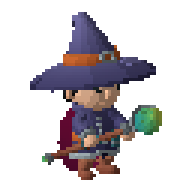 | 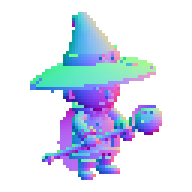 | 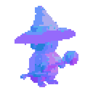 | 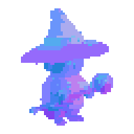 | 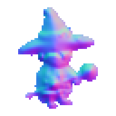 | 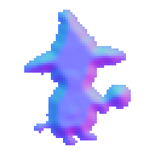 | 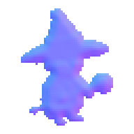 | 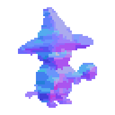 | 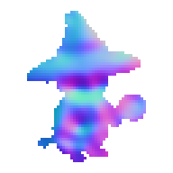 |
| watermill-a-64 | 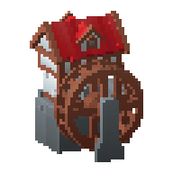 | 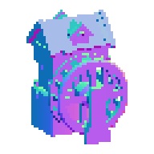 | 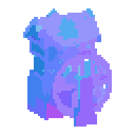 |  | 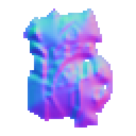 | 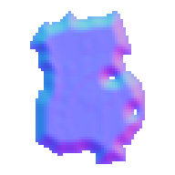 | 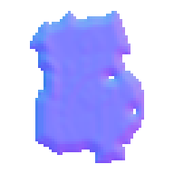 | 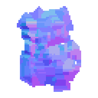 | 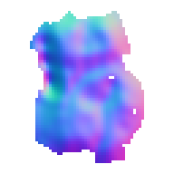 |

On hand-painted sprites we compare against the pack's own authored normal (CC-BY
Antifarea, Sprite DLight). +manual uses each sprite's labelled light azimuth.

| | Input | Authored | +auto | +manual | Relit |
| :---: | :---: | :---: | :---: | :---: | :---: |
| rabbit | 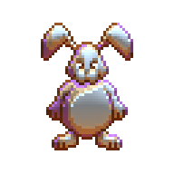 | 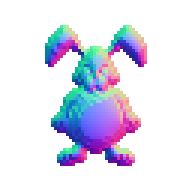 | 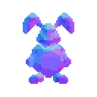 | 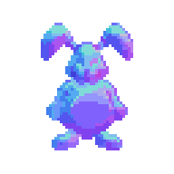 |  |
| captain | 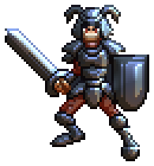 | 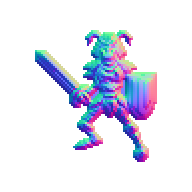 | 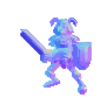 | 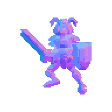 | 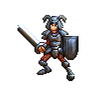 |

## Install

```bash
npm install @xprite/lighter
```

## Usage

```ts
import {
  createLightMaskGenerator,
  createNormalMapGenerator,
  defaultLightMaskOptions,
  defaultNormalMapLightOptions,
  defaultNormalMapOptions,
  generateNormalMap,
  prepareNormalMapLighting,
  renderNormalMapLighting,
  renderPreparedNormalMapLighting,
} from "@xprite/lighter";
```

Images are `{ width, height, data: Uint8ClampedArray }`, straight-alpha RGBA.

### Generate a normal map

```ts
const normal = generateNormalMap(sprite, { preset: "object" });
// or with cached segmentation when the same source is edited interactively:
const generator = createNormalMapGenerator(sprite, shadingSource);
const hint = generator.suggestPaintedLightAngle();
const normal = generator.generate({ preset: "character", facets: 40 });
```

Presets `architecture | character | object | terrain` change silhouette shape and facet density.
`generateNormalMap(input, options)`:

| Option | Description |
| --- | --- |
| `preset` | `architecture`, `character`, `object` (default), `terrain`. |
| `shapeStrength` | Overall height-field gain, 0–100. |
| `normalStrength` | Final normal tilt gain, 0–100. |
| `smoothing` | Box-blur passes on the height field, 0–6. |
| `facets` | Facet quantization density, 0–100. 0 = smooth normals. |
| `mergeOutlines` | Propagate normals into thin outline clusters. |
| `invertY` | Flip the green channel (DirectX convention). |
| `paintedLightAngle` | Direction the sprite was painted with, in degrees. Used with `paintedLightInfluence` to discount painted shading. |
| `paintedLightInfluence` | 0–100; how much of the sprite's shading to treat as painted light instead of geometry. `undefined` = auto-estimate. |

`createNormalMapGenerator(albedo, shading?)` caches the segmentation and lets you call
`suggestPaintedLightAngle()` once, then `generate(options)` cheaply per slider change.

### Generate a light mask

```ts
const mask = createLightMaskGenerator(albedo).generate(defaultLightMaskOptions());
```

A grayscale map of how much each cluster's interior should receive light. Used by
`prepareNormalMapLighting` to dim occluded regions.

### Relight

```ts
const prepared = prepareNormalMapLighting(albedo, normal, mask);
const lit = renderPreparedNormalMapLighting(prepared, {
  ...defaultNormalMapLightOptions(width, height),
  position: { x: width * 0.25, y: height * 0.1 },
  height: 40,
  brightness: 400,
  ambient: 30,
});
```

`prepareNormalMapLighting(albedo, normals, lightMask?)` precomputes linear colors, unit
normals and mask factors once; `renderPreparedNormalMapLighting(prepared, options)` re-renders
cheaply as the light moves.

`defaultNormalMapLightOptions(w, h)` returns `{ position, height, brightness, ambient, maskStrength, color, invertY }`.

## How it works

1. **Cluster.** Foreground pixels are grouped into 4-connected regions — exact RGB by default,
   or Lab ΔE growth (`LightingMapRegionMode.Perceptual`) when antialiasing breaks exact colors.
2. **Height field.** Silhouette distance (BFS from edges) plus normalized luminance; outline
   clusters marked thin and propagated last. `paintedLightSignal` estimates how much of the
   input's shading was painted, and `paintedLightAngle` tilts normals toward the estimated light.
3. **Facet.** Cluster means are quantized into 8 azimuth buckets × 4 tilt levels; large clusters
   split by direction support. Small sprites keep the concave √distance ramp; larger ones switch
   to a linear ramp that preserves fold direction better.
4. **Clean up.** ≤2 px same-direction fragments take their cluster's normal; `mergeOutlines`
   propagates into the thin ring; `invertY` optionally flips green.

[`src/`](src) documents each stage. The editor side of this pipeline lives in
[xprite-normal-maps](https://github.com/rhinoc/xprite-normal-maps) under
`apps/editor/src/managers/normal-maps/` and `components/normal-maps/`.

## Benchmark

`bench/` scores every method on the same 64 cases (8 KayKit CC0 models × 2 views × 4 sizes).
GT is the smooth interpolated mesh normal; relit targets are 5-band cel renders at 4 unseen
directions. Macro means below, at 30° boundary threshold.

| Method | AP ↑ | aligned recall ↑ | false edge ↓ | mean angle ° ↓ | relit MAE ↓ |
|---|---:|---:|---:|---:|---:|
| Xprite +auto hint | 0.518 | 14.43 | 1.30 | 38.06 | 29.83 |
| Xprite +manual hint (160°) | **0.521** | **14.78** | 1.12 | 38.61 | 30.19 |
| Sprite Fusion | 0.317 | 3.65 | 2.76 | **37.57** | 30.37 |
| SpriteLab | 0.290 | 0.05 | 0.04 | 38.74 | 29.71 |
| Bump It | 0.311 | 0.08 | **0.01** | 41.38 | **29.68** |
| Pixel Art Lighter upstream | 0.287 | 4.75 | 4.42 | 40.03 | 29.95 |
| Laigter | 0.276 | 0.43 | 0.95 | 47.10 | 33.24 |

AP and aligned recall measure whether the *folds* land where the GT's facets
break — our quantized facets win these despite a higher smooth-GT angle error.
See [`bench/README.md`](bench/README.md) for metric definitions, per-case CSVs,
and the light-mask variant results.

## Demo & bench

- `pnpm run demo` serves a live browser demo (`demo/index.html`) comparing authored and generated
  normals on an OpenGameArt monster sheet (CC-BY 3.0, Antifarea) and the mesh-GT corpus.
- `pnpm run bench` scores `generateNormalMap` against 64 mesh-GT cases (8 KayKit CC0 models ×
  2 views × 4 sizes) and the competitors above. Metrics: mean/median angular error, acc@11.25°,
  boundary AP, aligned recall, false edge, relit cel MAE.

## License

MIT. Third-party notices in [`LICENSES/`](LICENSES/).
